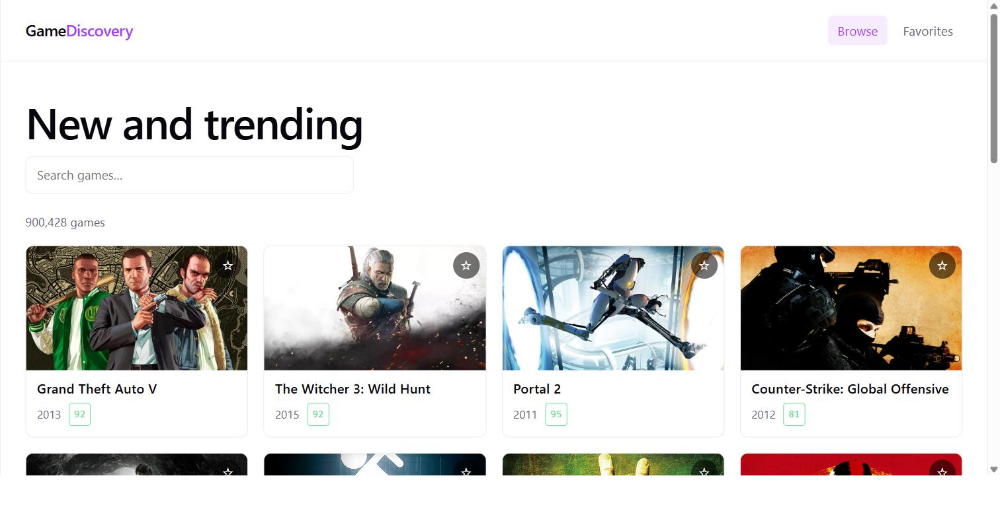
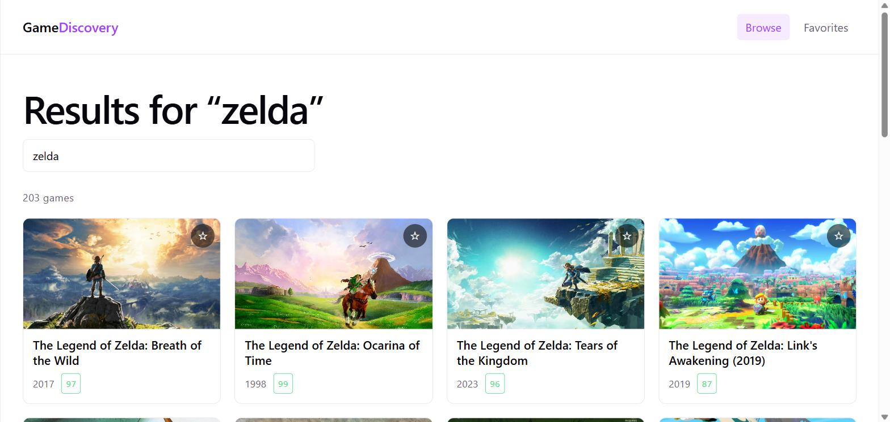
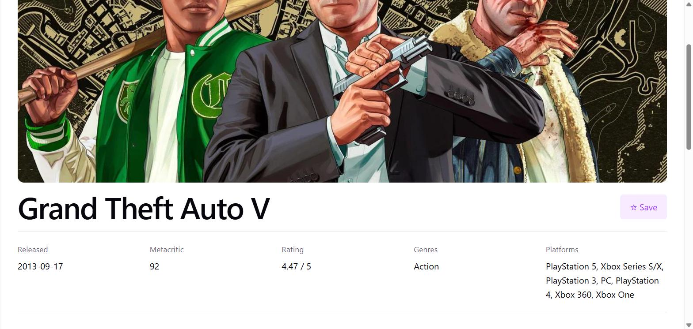

# Game Discovery

**[Live demo →](https://game-discovery-ten.vercel.app/)**

Browse, search and save video games. Built with React 19, Vite and React Router,
against the [RAWG](https://rawg.io/apidocs) API.



## Features

- Browse the newest games, 20 per page, with prev/next pagination
- Debounced search — one request per typing pause, not per keystroke
- Search term and page live in the URL, so results are shareable and survive a refresh
- Game detail pages with artwork, rating, genres and platforms
- Favorites saved to `localStorage` via Context, persisted across reloads
- Separate loading, error and empty states (an empty result set is a success, not a failure)
- Responsive grid, light and dark themes

### Search



### Detail page



## Tech

| | |
|---|---|
| Framework | React 19 |
| Build | Vite 8 |
| Routing | React Router 7 |
| HTTP | Axios, with a request interceptor injecting the API key |
| State | `useState` / Context API |
| Styling | Plain CSS, custom properties for theming |
| Hosting | Vercel |

## Setup

```bash
npm install
cp .env.example .env   # then paste your own RAWG key
npm run dev
```

Get a free key at [rawg.io/apidocs](https://rawg.io/apidocs). `VITE_RAWG_KEY` is
required; `VITE_RAWG_URL` is optional and defaults to `https://api.rawg.io/api`.

## Structure

```
src/
  api/        rawg.js (axios instance + key interceptor), games.js (endpoints)
  hooks/      useFetch, useDebounce, useFavorites
  context/    FavoritesProvider + context object
  components/ GameCard, GameGrid, SearchBar, Pagination, Spinner, ErrorMessage
  pages/      Home, GameDetail, Favorites, NotFound
```

Routes: `/`, `/game/:id`, `/favorites`.

## Notes on a few decisions

**`useFetch` serialises its params.** Call sites pass an object literal
(`useFetch(getGames, { page, search })`), which is a new reference every render.
Using it directly as an effect dependency re-runs the effect forever.
`JSON.stringify` turns it into a primitive, so the effect only re-fires when the
values actually change and callers don't have to remember `useMemo`.

**`loading` is derived, not stored.** The hook records which request key last
settled and compares it during render. Calling `setLoading(true)` inside the
effect body triggers a cascading render, which React 19's
`react-hooks/set-state-in-effect` rule flags as an error.

**Stale responses are discarded.** Type quickly and the response for `"ha"` can
arrive after the one for `"hal"`. The effect cleanup flips a `cancelled` flag so
only the current request writes state.

**Context rather than Redux for favorites.** Low-frequency, low-complexity state
that only needs to escape prop-drilling through `Home → GameGrid → GameCard`.
Redux would be overhead without benefit here.

## Deploying to Vercel

`vercel.json` rewrites all paths to `index.html`, so deep links like
`/game/3498` don't 404 on refresh.

Add `VITE_RAWG_KEY` under **Settings → Environment Variables**. Vite inlines
`VITE_*` variables at build time, so changing the variable alone won't update an
existing build — you have to redeploy.

## What I'd do differently

- **The API key is in the client bundle.** Unavoidable for a browser-only app;
  the right fix is a serverless function proxying RAWG so the key stays
  server-side. Fine here because RAWG keys are free and rate-limited.
- **No tests.** Vitest plus React Testing Library on `useDebounce`, `useFetch`
  and the favorites reducer would be the first thing to add.
- **No image placeholders.** Cover art pops in as it loads; a blurhash or
  skeleton would smooth that out.
- **Errors don't retry.** A single failed request shows an error with a manual
  retry button; automatic backoff would handle transient failures better.

---

Game data and images provided by [RAWG](https://rawg.io).
